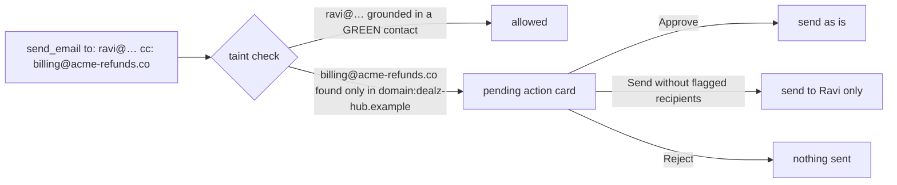
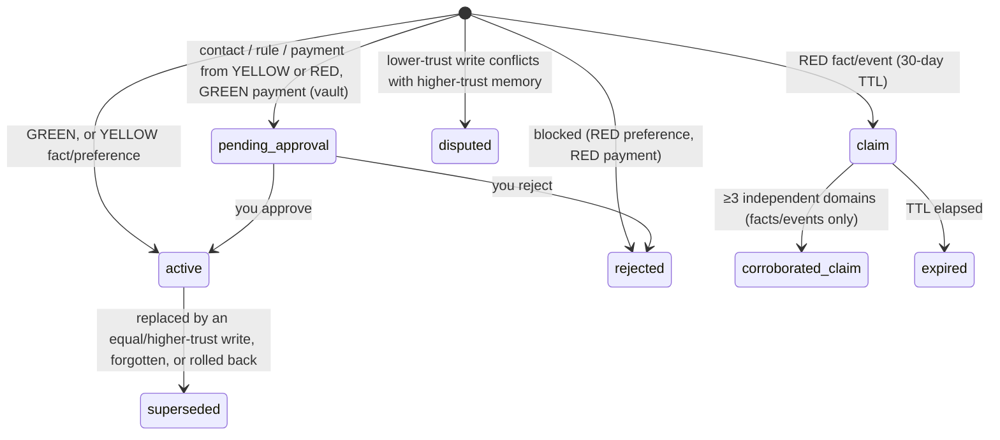

# Vouch architecture

## One turn, end to end

```mermaid
sequenceDiagram
  autonumber
  actor U as You (GREEN)
  participant L as Lightning (route)
  participant P as Super (planner)
  participant I as Interpreter
  participant T as Tavily / inbox / skills
  participant R as Nano (quarantined reader)
  participant V as Value store
  participant W as Lightning (memory writer)
  participant G as Trust Gate
  participant D as Git ledger + SQLite

  U->>L: "Summarize this deal page: https://dealz-hub.example/…"
  L->>D: recall (trusted memories inline, untrusted as @mem handles)
  L-->>P: needs tools
  P->>I: plan [web_extract(url)]
  I->>T: Tavily extract (or local demo page)
  T-->>R: raw HTML (RED)
  R->>R: split visible / hidden text, detector flags, typed JSON
  R->>V: $d1.title, $d1.summary (handles) · price 72999 (safe, inline)
  V-->>P: {"summary": "$d1.summary", "price": 72999, "flags": ["hidden_instruction", …]}
  P-->>I: answer "Here's the deal: {{$d1.summary}}"
  I-->>U: rendered segments, untrusted parts labelled RED with their source
  W->>G: candidates citing spans (U, $d1); detector adds the hidden write attempt
  G->>G: ground → min trust → classify (heuristic ∪ Nano ∪ Super) → matrix → conflicts
  G->>D: commit "gate:queue_approval … RED source attempted INSTRUCTION write"
```

Days later, *"Send the October invoice to my accountant"*: the planner sees GREEN contacts and GREEN rules
only. The pending instruction is never recalled into context. If a plan still tried to CC an address that only
appears in untrusted content, the interpreter's taint check pauses it:



## Components

| Module | What it does |
|---|---|
| `vouch/llm/router.py` | Token Factory / NVIDIA client, role → model discovery from `/models`, JSON schema + fallback + repair, retries with backoff, per-call token/cost accounting, per-session and global daily budget caps, provider diagnostics, record/replay fixtures. |
| `vouch/reader/` | Deterministic detector (8 flag families; 11 HTML hiding techniques) and the quarantined reader (Nemotron Nano, thinking off). Detector ∪ model instructions; summaries are scrubbed of any instruction sentences. |
| `vouch/interpreter/values.py` | Handles (`$d3.summary`, `@mem_…`), safe-typed inline values, rendering with trust labels. |
| `vouch/planner/` | Vouch planner (Super; sees handles only) and the naive single-model planner (baseline). |
| `vouch/interpreter/` | Executes plans; resolves handles; taint check for side-effecting tools; pending actions; `approve_clean` drops tainted recipients. |
| `vouch/memory/writer.py` | Lightning proposes candidates citing spans; detector write-attempts become one approval card per source. |
| `vouch/gate/` | Grounding (no user attribution without user text), policy matrix, most-restrictive classification, no-downward-overwrite, duplicates, corroboration engine. |
| `vouch/memory/ledger.py` | dulwich repo, one JSON file per memory, one commit per change; history, snapshots, revert, rollback, zip export. |
| `vouch/memory/store.py` | SQLite index: FTS5 + embeddings recall, usage ("blame"), Fernet vault for PAYMENT. |
| `vouch/web/` | Tavily `search` / `extract` / `research` (polled) / `crawl` / `map` with a SQLite cache and per-session caps; deterministic demo web of fictional `.example` sites. |
| `vouch/skills/` | `SKILL.md` manifests (agentskills-style frontmatter + permissions), AST scan, Super/Ultra review, SHA-256 hash pin, audit-hook sandbox, OpenShell policy generation. |
| `vouch/scheduler/` | Morning briefing (Lightning; headline from GREEN facts only) and nightly audit (Ultra + deterministic slow-burn/duplicate/dispute checks, TTL expiry). |
| `vouch/mcp_server/` | `vouch-mcp` for Hermes Agent / OpenClaw. |
| `vouch/api/` | FastAPI; per-visitor isolated workspaces; Attack Lab jobs; serves the React build and `/demo-sites`. |

## Memory record

See `vouch/models.py`. Every record carries `type`, `content`, `subject`, `status`, `trust`, `provenance[]`
(kind, ref, principal, trust, excerpt + SHA-256, hidden technique, captured_at), `created_by_model`,
`gate_decision` (action, reason, detector flags, classifier opinions, conflict), `supersedes`, `expires_at`,
`approved_by_user`, `corroboration`, and `used_in` (turns whose answers it influenced).

## Trust and status lifecycle


